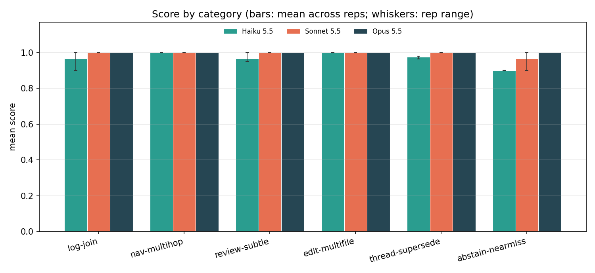
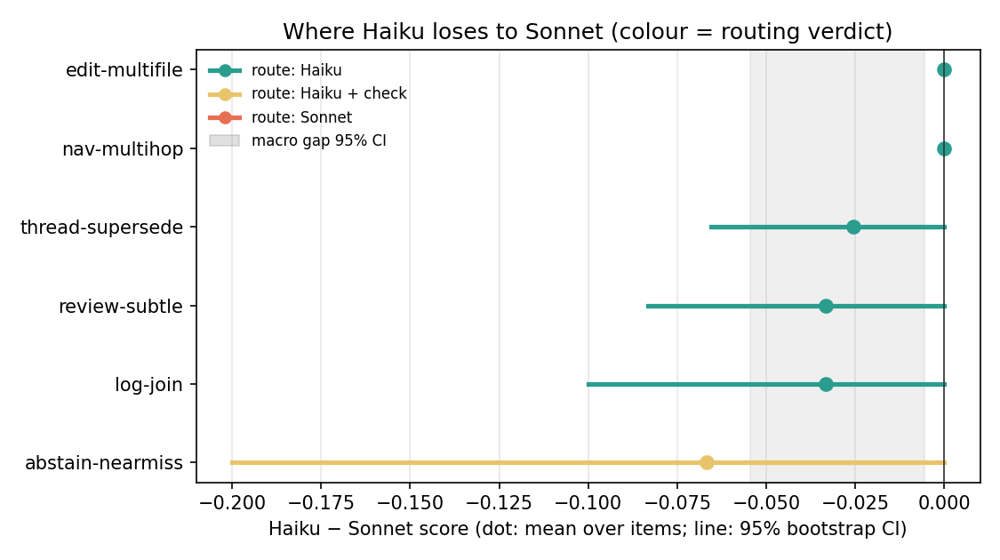
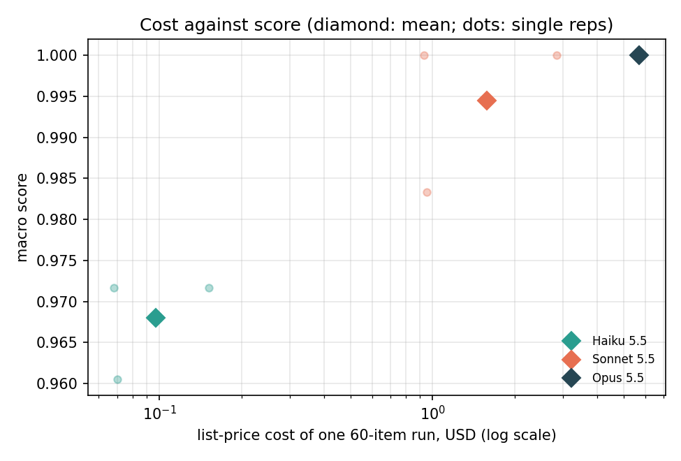
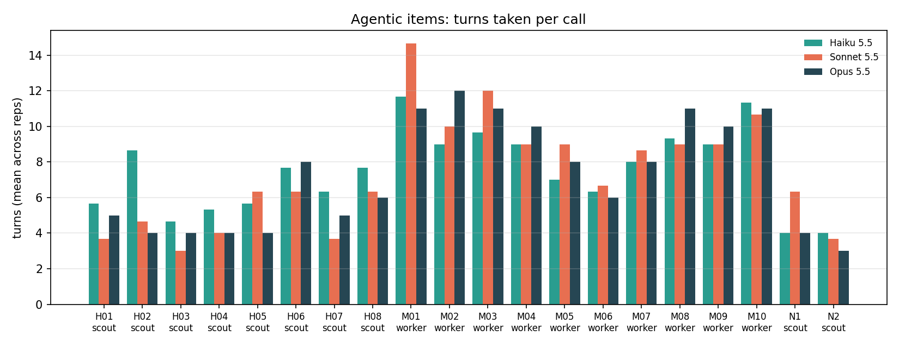
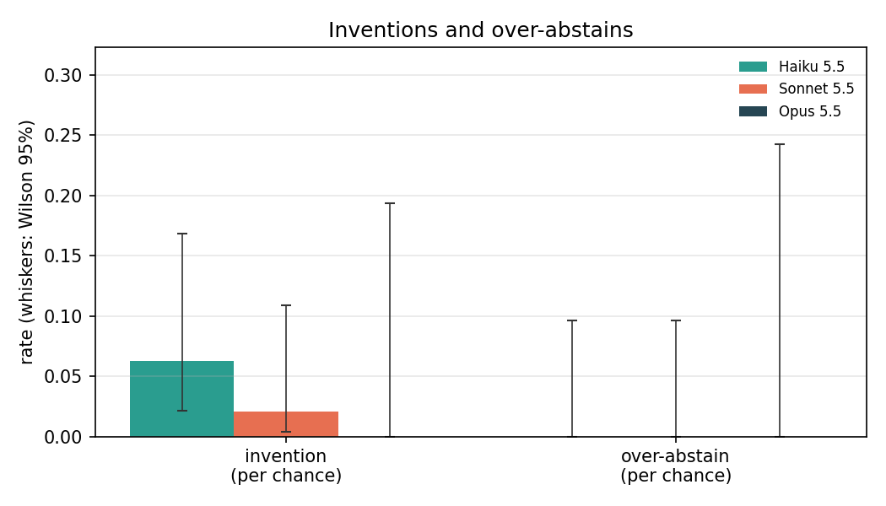

# Results: Haiku 5.5 on harder delegations

Run on 2026-10-18 with Claude Code 2.1.302. The design, hypotheses and
routing rule are in [DESIGN.md](DESIGN.md) and [METHODS.md](../METHODS.md),
committed before any model was called. Every number below comes from
[results/tables.md](results/tables.md) and
[results/summary.json](results/summary.json), which `analyze.py` generates.

## Headline

This tier failed the purpose it was built for. DESIGN.md set the bar in
advance: "If Opus and Sonnet both reach 0.97, the tier has failed its
purpose and is reported that way, not reworked after the fact." Opus 5.5
scored 1.000 and Sonnet 5.5 scored 0.994. No item was changed.

Haiku 5.5 scored 0.968. It trailed Sonnet by 0.026 on the macro score
(95% CI 0.006 to 0.055). The interval excludes zero, but the gap is about
half the 0.05 the first hypothesis asked for. Five of the six categories
route to Haiku under the routing rule. The sixth, abstain-nearmiss, routes
to Haiku with a check, and almost all of that comes from one item (N04,
below). Sonnet cost about 16 times as much for the same 60 items ($1.577
against $0.097 per run).

In two synthetic benchmarks now, every model has scored near the maximum:
the first one, and this one, which is built from the six harder kinds of
item the first one's limits section named (log joins, multi-hop
navigation, subtler review bugs, multi-file edits, threads that supersede
earlier values, and unanswerable questions with near-miss distractors).
The only measurement that has separated Haiku from Sonnet is the private
email anchor (84.7% against 91.7%, McNemar p = 0.0005), which asks for
judgment on real mail with no stated rule. Every item here states its rule and has one
checkable answer. That difference is our guess at why the anchor separates
the models and these items do not; this run did not test it.

## Overall

| Model | Reps | Macro score (rep range) | Cost per 60-item run | Cost per call | Thinking tokens per call | Seconds per call | Inventions | Over-abstains | Same score every rep |
|---|---|---|---|---|---|---|---|---|---|
| Haiku 5.5 | 3 | 0.968 (0.961–0.972) | $0.097 | $0.0016 | 540 | 8.2 | 3 / 48 | 0 / 36 | 93% of items |
| Sonnet 5.5 | 3 | 0.994 (0.983–1.000) | $1.577 | $0.0263 | 261 | 9.7 | 1 / 48 | 0 / 36 | 98% of items |
| Opus 5.5 | 1 | 1.000 | $5.695 | $0.0949 | 234 | 12.8 | 0 / 16 | 0 / 12 | – |

The macro score averages the six category means, so each category counts
equally. An **invention** is a confident answer where gold is "not in the
input" (unanswerable abstain-nearmiss and nav-multihop items, and
thread-supersede fields that end up unsettled). An **over-abstain** is
"not in the input" where gold has an answer. Each rep has 16 chances for
the first and 12 for the second.

All 420 calls returned the JSON the item asked for. None failed or timed
out, none needed a retry, and every reply came from the model that was
requested.

An item counts as passed when it scores 1.0 on at least two of three reps
(Opus: its one rep). Haiku passed 58 of 60 (97%, Wilson 95% interval 89–99%),
Sonnet and Opus all 60 (94–100%). The two items only Sonnet passed are N04
and T05; there is no item only Haiku passed, so the exact McNemar test
gives p = 0.50.

## Routing by category

| Category | n | Mode | Haiku | Sonnet | Opus | Haiku / Sonnet | Gap (95% CI) | Inventions H / S | Sonnet cost × Haiku | Route |
|---|---|---|---|---|---|---|---|---|---|---|
| log-join | 10 | single | 0.97 | 1.00 | 1.00 | 97% | −0.03 (−0.10 to 0.00) | 0 / 0 | 19.5× | Haiku |
| nav-multihop | 10 | scout | 1.00 | 1.00 | 1.00 | 100% | +0.00 | 0 / 0 | 10.9× | Haiku |
| review-subtle | 10 | single | 0.97 | 1.00 | 1.00 | 97% | −0.03 (−0.08 to 0.00) | 0 / 0 | 17.7× | Haiku |
| edit-multifile | 10 | worker | 1.00 | 1.00 | 1.00 | 100% | +0.00 | 0 / 0 | 15.8× | Haiku |
| thread-supersede | 10 | single | 0.97 | 1.00 | 1.00 | 97% | −0.03 (−0.07 to 0.00) | 0 / 0 | 16.4× | Haiku |
| abstain-nearmiss | 10 | single | 0.90 | 0.97 | 1.00 | 93% | −0.07 (−0.20 to 0.00) | 3 / 1 | 20.1× | Haiku + check |

Across categories the macro gap is −0.026 (95% CI −0.055 to −0.006, paired
bootstrap over items within category). Abstain-nearmiss would route to
Haiku with a check on either condition of the rule: its score is 93% of
Sonnet's, inside the 85–95% band, and Haiku invented there more often.

## Hypotheses

- **H1, not supported.** Sonnet is ahead by 0.026 and the interval
  (0.006 to 0.055) excludes zero, but the hypothesis asked for at least
  0.05.
- **H2, not supported: the tier failed.** Opus scored 1.000 and Sonnet
  0.994, both above the 0.97 that DESIGN.md set as failure.
- **H3, supported.** Opus 1.000 ≥ Sonnet 0.994 ≥ Haiku 0.968.
- **H4, not supported.** The largest gap is abstain-nearmiss (0.067).
  Log-join and review-subtle trail at 0.033 and thread-supersede at 0.026;
  nav-multihop and edit-multifile show none.
- **H5, supported by count only.** Haiku invented on 3 of 48 chances (6%,
  2–17%) and Sonnet on 1 of 48 (2%, 0–11%). The intervals overlap, and all
  four inventions are on one item, N04, where they are better read as a
  broken answer contract than as made-up facts (below).
- **H6, not supported.** Only abstain-nearmiss routes away from plain
  Haiku; the hypothesis needed two categories.
- **H7, supported as stated, but the stated reason fits only one mode.**
  Sonnet's cost multiple is 18.8× on single calls, 10.9× in scout mode and
  15.8× in worker mode. DESIGN.md expected the drop because Haiku takes
  more turns. That holds for scout: on nav-multihop Haiku took 6.0 turns
  per call against Sonnet's 4.8 and Opus's 4.7. On edit-multifile Haiku
  took fewer turns (9.0 against 9.9), so the smaller worker multiple has
  some other cause, which this run did not isolate.

## The calls that lost points

Eleven of the 420 calls scored below 1: ten of Haiku's 180 and one of
Sonnet's 180. Opus lost no points.

- **N04, abstain-nearmiss: all three Haiku reps and Sonnet rep 2 (0 each,
  counted as inventions).** The question asks at what p99 latency a canary
  deployment of the (invented) Tallowmere Search API pages the on-call
  engineer, and gold is `NOT_FOUND`. The document says the alerts "exclude
  canary instances from their queries, so a canary never pages through
  them"; canary health is judged by an automated comparison with the rest
  of the fleet, and the 800 ms threshold applies to the rest of production.
  These four replies put a sentence in the answer field, for example "A
  canary never pages at any p99 latency", instead of `NOT_FOUND`. Opus and
  Sonnet's other two reps explained the same point in their prose and
  still answered `NOT_FOUND`. None of the four states a fact the document
  lacks; each rejects the question's premise. Under the scoring rule fixed
  in advance they are inventions and stay in the primary result. For a
  delegator the cost is narrow: code that checks the answer field
  for `NOT_FOUND` gets an unexpected sentence, and a person reading it gets
  a correct one.
- **T05, thread-supersede: all three Haiku reps (0.8 each).** The client
  asks to drop the second shooter. The vendor replies "Sure, no second
  shooter. That brings it to $3,100." The client's next message says they
  will talk it over with someone else, and a later one, quoting the
  vendor's reply, says "Still deciding on the second shooter." Gold reads
  the reply as a counter-offer the client never accepted, so
  `second_shooter` stays true. Haiku kept
  the old price but read "Sure" as agreeing to the removal, giving
  `second_shooter: false`. The client's later messages favour the gold, but
  the stated rule allows both readings. Sonnet and Opus matched the gold.
- **J05, log-join: Haiku rep 3 (0).** It counted 13 ERROR lines while api
  v2.4.1 was live; gold is 14. Version v2.4.1 was live over more than one
  window. Haiku's other two reps got 14.
- **R02 and R08, review-subtle: Haiku rep 2 and rep 1 (0.5 each).** Both
  times Haiku found the seeded bug (an `lstrip` used as a prefix strip at
  line 44; a dropped blank-tag filter at line 26) and also reported the
  place where the bad value is used (line 92, `thumbnails()`, which calls
  `original_name`; line 36, `add_tags`, which consumes `parse_tags`). The
  grader counts any line more than two away from the seeded one as a false
  positive. These second findings point at the same defect, so the lost
  half points are debatable, like item r2 in the first benchmark.
- **T02, thread-supersede: Haiku rep 3 (0.833).** The prompt says today is
  2026-11-12 and the thread agrees a start on "January 11". Haiku cited the
  right messages and wrote `2026-01-11`, a date already past; gold is
  `2027-01-11`. The CLI's injected real date (2026-10-18) also puts the
  next January 11 in 2027, so it does not explain the miss.

Four of these misses (J05, R02, R08, T02) happened on a single rep, which
is why Haiku's scores agree across reps on 93% of items against Sonnet's
98%. N04 and T05 happened on every Haiku rep.

## Post-hoc sensitivity (not pre-registered)

We chose this check after the runs, once we had read the misses above, so
it carries less weight than the results before it. It drops whole items
and changes no gold. The first row is the pre-registered result.

| Items dropped | Haiku | Sonnet | Opus | Gap Haiku − Sonnet (95% CI) | Inventions H / S | Routed away from Haiku | H1 | H2 | H5 | H6 |
|---|---|---|---|---|---|---|---|---|---|---|
| none (pre-registered) | 0.968 | 0.994 | 1.000 | −0.026 (−0.055 to −0.006) | 3/48, 1/48 | abstain-nearmiss | no | no | yes | no |
| N04 | 0.985 | 1.000 | 1.000 | −0.015 (−0.031 to −0.004) | 0/45, 0/45 | none | no | no | no | no |
| N04, T05 | 0.988 | 1.000 | 1.000 | −0.012 (−0.026 to −0.001) | 0/45, 0/45 | none | no | no | no | no |

Without N04 there are no inventions at all and every category routes to
Haiku. Haiku still trails by a small amount whose interval excludes zero,
from the single-rep misses listed above. H1, H2 and H6 stay unsupported
in both variants, and H5 loses its support.

## Exploratory

- **Haiku thinks longer.** It used 540 thinking tokens per call against
  Sonnet's 261 and Opus's 234, and the most on log-join (1,027 against 575
  and 452). On nav-multihop and edit-multifile Sonnet barely thought (19
  and 47 tokens per call, against Haiku's 284 and 465). Haiku was still
  the fastest per call and about 16 times cheaper.
- **Caching.** The first rep of each model cost more than the later two:
  Haiku $0.152 against $0.068 and $0.070, Sonnet $2.851 against $0.950 and
  $0.932. This looks like prompt caching across reps, which is one more
  reason to compare ratios rather than dollars.
- **Traps.** Both edit-multifile items that need a file outside the write
  set (M08, M09) scored 1.0 for every model on every rep: the hidden tests
  passed, no file outside the write set changed, and the report named the
  file the change also needs.

## Pilot

Before rep 1, one item per category (J01, H01, R01, M03, T01, N01) ran
against Haiku as rep 0 to check the harness. All six calls returned
replies that parsed. No harness change followed, so DESIGN.md has no dated
entry for one. Pilot replies are not analysed and not committed.

## Gold check

METHODS.md requires re-examining any item that every model fails. Opus
scored 1.000 on all 60 items, so no item qualified and no gold was changed.

## Limits

- **Ceiling.** Like the first benchmark, this set does not separate the
  three models, so it cannot say where Haiku stops being good enough. Each
  category score rests on 10 items; a category mean of 0.97 can come from
  one miss in 30 calls.
- **Stated rules.** Every item gives its rule and has one checkable answer.
  Real delegations often leave the rule to the model, which is what the
  anchor tests.
- **Who wrote the items.** The generators were written with Claude's help,
  so the items may sit inside what Claude models handle well. Gold comes
  from the generators' own events, the pinned repository, executed tests
  and assertions on the documents, never from a model's answer.
- **Cost.** Dollar figures are the CLI's list price on a subscription, and
  prompt caching moves them (see Exploratory). Compare ratios, not amounts.
- **One setup.** One CLI version, one day, default effort, and the prompts
  and flags C3 v2.157.2 uses.
- **Injected date.** Every call sees the machine's real date as well as the
  date the prompt states. The one date miss (T02) is not explained by it.

## Figures



Mean score by category for each model; the whiskers are the range across
reps.



Haiku's score minus Sonnet's by category, with 95% bootstrap intervals,
coloured by routing verdict. The shaded band is the macro gap's interval.



Macro score against the list-price cost of one 60-item run, on a log
scale. Diamonds are each model's mean; dots are single reps.



Turns per call on each nav-multihop and edit-multifile item, averaged
across reps.



Invention and over-abstain rates per chance, with Wilson 95% intervals.

## Reproduce

From the repository root, check out the fixture repository at the pinned
commit (the same one the first benchmark uses):

```
git clone https://github.com/drknowhow/code-context-control .cache/c3
git -C .cache/c3 checkout 931cb4de72b140a39130e8c7c06a86f25bf6c310
```

Then, from `haiku-delegation-bench-hard/`, with Python 3.11+ and the
`claude` CLI signed in:

```
python build.py                       # builds fixtures/items.jsonl and checks every gold value
python grade.py --self-test
python run.py --model claude-haiku-5-5  --reps 1 2 3 --workers 4
python run.py --model claude-sonnet-5-5 --reps 1 2 3 --workers 4
python run.py --model claude-opus-5-5   --reps 1     --workers 4
python run.py --model <model> --reps <reps> --retry-errors   # reruns failed calls once
python grade.py
python analyze.py                     # writes results/tables.md, summary.json and figures/
```

The raw replies for every call are in `results/raw/`, one file per model
and rep, with a `.meta.json` recording the CLI version, concurrency and
fixture commit. The prompt assembly, reply parser and hidden-test runner
are shared with the first benchmark in `../_lib/`; moving them there left
the first benchmark's rebuilt items and regraded scores byte-identical
(commit dd6fc07).
