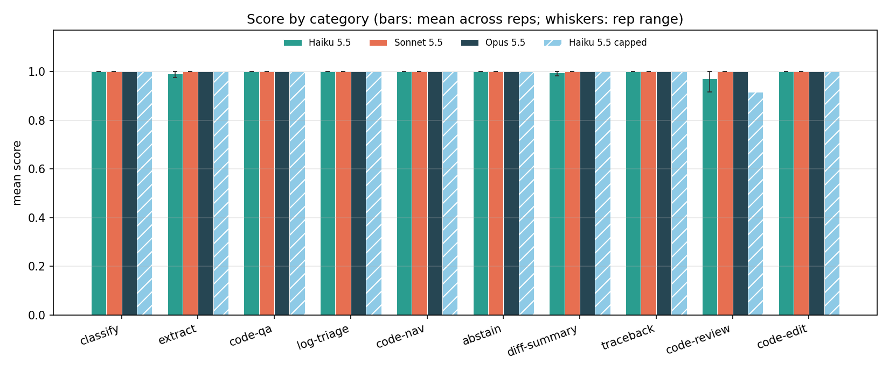
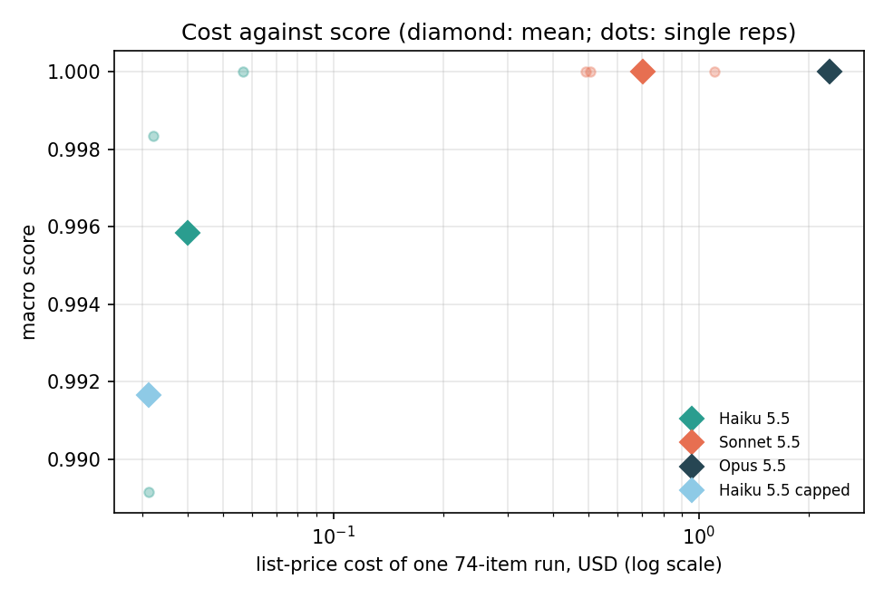
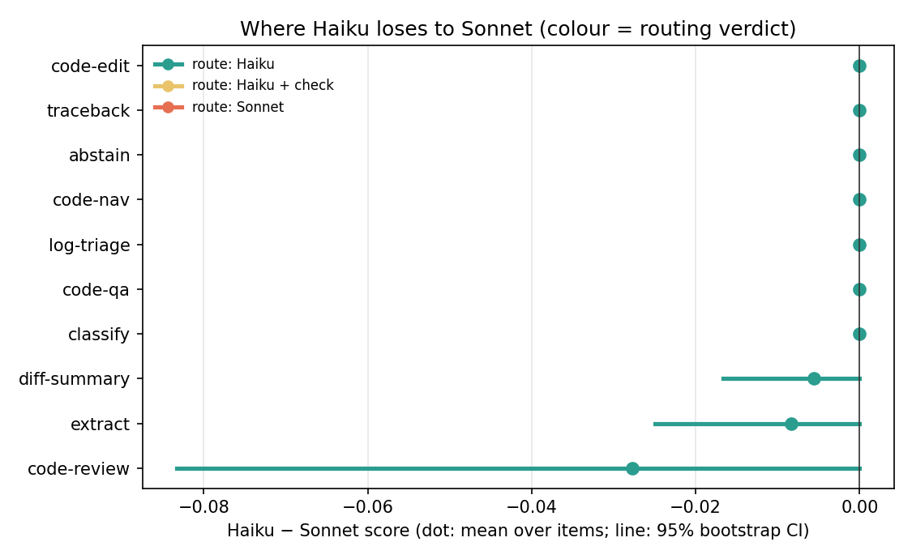
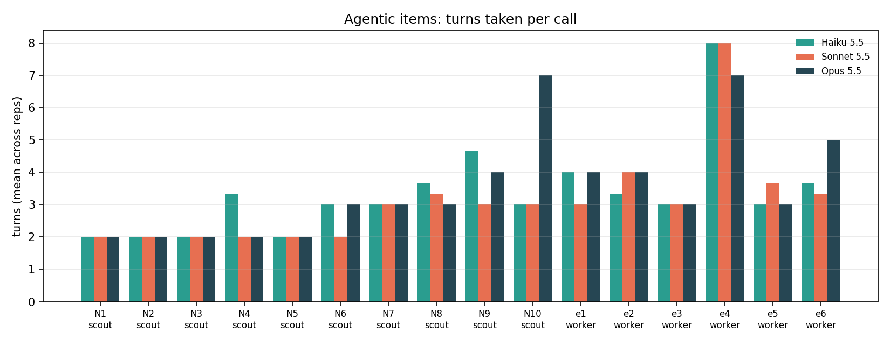

# Results: Haiku 5.5 as a delegate

Run on 2026-10-17 with Claude Code 2.1.302. The design, hypotheses and
routing rule are in [DESIGN.md](DESIGN.md) and [METHODS.md](../METHODS.md),
fixed before any model was called. Every number below comes from
[results/tables.md](results/tables.md) and
[results/summary.json](results/summary.json), which `analyze.py` generates.

## Headline

On 74 bounded delegation tasks, Haiku 5.5 scored the same as Sonnet 5.5
within the noise: a macro score of 0.996 against 1.000. Under the routing
rule we fixed in advance, every one of the ten categories routes to Haiku.
At list price Sonnet cost about 17.5 times as much for the same 74 items
($0.701 against $0.040 per run).

The set turned out to be too easy to separate the models. Opus also scored
1.000, and Haiku lost points on only 3 of its 222 calls. On our private
email-triage set, a harder judgment task, Haiku was clearly behind Sonnet
(84.7% against 91.7%, exact McNemar p = 0.0005; see
[anchor/RESULTS.md](anchor/RESULTS.md)). The fair reading is that Haiku is
reliable on well-specified, bounded delegations, not that it equals Sonnet
in general.

## Overall

| Model | Reps | Macro score (rep range) | Cost per 74-item run | Cost per call | Seconds per call | Inventions | Over-abstains | Same score every rep |
|---|---|---|---|---|---|---|---|---|
| Haiku 5.5 | 3 | 0.996 (0.989–1.000) | $0.040 | $0.00054 | 6.7 | 0 / 33 | 0 / 36 | 96% of items |
| Sonnet 5.5 | 3 | 1.000 | $0.701 | $0.0095 | 7.5 | 0 / 33 | 0 / 36 | 100% of items |
| Opus 5.5 | 1 | 1.000 | $2.276 | $0.0308 | 10.4 | 0 / 11 | 0 / 12 | – |
| Haiku 5.5, thinking capped (exploratory) | 1 | 0.992 | $0.031 | $0.00042 | 5.5 | 0 / 11 | 0 / 12 | – |

The macro score averages the ten category means, so each category counts
equally. An **invention** is a confident answer where gold is "not in the
input"; an **over-abstain** is "not in the input" where gold has an answer.
Each rep has 11 chances for the first and 12 for the second.

All 592 calls returned the JSON the item asked for, none failed or timed
out, and every reply came from the model that was requested.

## Routing by category

| Category | n | Haiku | Sonnet | Opus | Haiku / Sonnet | Gap (95% CI) | Sonnet cost × Haiku | Route |
|---|---|---|---|---|---|---|---|---|
| classify | 10 | 1.00 | 1.00 | 1.00 | 100% | +0.00 | 19.1× | Haiku |
| extract | 8 | 0.99 | 1.00 | 1.00 | 99% | −0.01 (−0.03 to 0.00) | 28.7× | Haiku |
| code-qa | 8 | 1.00 | 1.00 | 1.00 | 100% | +0.00 | 17.3× | Haiku |
| log-triage | 6 | 1.00 | 1.00 | 1.00 | 100% | +0.00 | 19.7× | Haiku |
| code-nav | 10 | 1.00 | 1.00 | 1.00 | 100% | +0.00 | 12.1× | Haiku |
| abstain | 8 | 1.00 | 1.00 | 1.00 | 100% | +0.00 | 18.2× | Haiku |
| diff-summary | 6 | 0.99 | 1.00 | 1.00 | 99% | −0.01 (−0.02 to 0.00) | 15.6× | Haiku |
| traceback | 6 | 1.00 | 1.00 | 1.00 | 100% | +0.00 | 18.4× | Haiku |
| code-review | 6 | 0.97 | 1.00 | 1.00 | 97% | −0.03 (−0.08 to 0.00) | 16.8× | Haiku |
| code-edit | 6 | 1.00 | 1.00 | 1.00 | 100% | +0.00 | 15.4× | Haiku |

Across categories the macro gap is −0.004 (95% CI −0.010 to 0.000, paired
bootstrap over items within category). Neither model invented in any
category, so the invention condition in the routing rule never applied.

## Hypotheses

- **H1, supported.** On the mechanical categories Haiku reached at least
  95% of Sonnet's score: classify 1.00, extract 0.99, code-qa 1.00,
  log-triage 1.00.
- **H2, supported on paper but not shown.** The pre-registered test
  compares mean gaps: 0.008 on judgment categories against 0.002 on
  mechanical ones. Both gaps are inside the spread between reps and come
  from two items (r2 and d04, below), so this run does not show a widening
  gap. The anchor is better evidence that Haiku trails on judgment.
- **H3, not supported.** Neither model invented anything: 0 of 33
  chances each.
- **H4, supported, but the effect is small.** In the agentic modes Haiku
  averaged 3.35 turns per task against Sonnet's 3.08, and Sonnet's cost
  multiple falls from 19.4× on single calls to 13.7× on agentic ones. The
  extra turns are all in code-nav (2.9 against 2.4); on code-edit both
  models averaged 4.2. Haiku is still about 14 times cheaper per agentic
  task.
- **H5, supported.** Haiku 5.5 scored 84.7% [80.2, 88.3] on the anchor,
  above Haiku 4.5's 68.3% and below Sonnet 5.5's 91.7%. The 68.3% came from
  a run that sent 50 emails per call, so the comparison spans two setups as
  well as two models. Details in [anchor/RESULTS.md](anchor/RESULTS.md).

## The calls that lost points

Four of the 592 calls scored below 1, all from Haiku.

- **x07, extract, rep 2 (0.8).** Haiku left the date empty. The prompt says
  today is 2026-03-11 and the meeting is "Tuesday the 24th", which gold
  reads as 2026-03-24. Haiku's reply said the context gave a second current
  date that would make it 24 November. After the run we checked: the CLI
  adds the machine's real date ("Today's date is 2026-10-17") to every
  call, even with its default system prompt replaced. Sonnet and Opus used
  the date in the prompt. Real delegations get the same injected date, so
  relative dates in a delegated task can be read against the wrong day.
- **r2, code-review, rep 2 and the capped rep (0.5 each).** Haiku found
  the seeded bug (the cache key is the constant `"rate"`, so every currency
  gets the first currency's rate) and then reported a second defect: the
  cache never expires. The task asked only for defects that make the code
  behave incorrectly, and the grader counts the second finding as a false
  positive. A reviewer could reasonably call stale rates a defect, so this
  loss is debatable.
- **d04, diff-summary, rep 3 (0.9).** Right file and right change type, but
  the summary never says the change is to the README or to documentation,
  which is one of three required keyword groups.

## Exploratory: Haiku with C3's thinking cap

C3 runs its small-tier delegations with `MAX_THINKING_TOKENS=1024`, so one
extra Haiku rep ran with that cap. It scored 0.992; its only miss was r2
again. Mean thinking per call barely moved (207 tokens against 218
uncapped), so the cap rarely binds on tasks this size. The capped run was
23% cheaper, mostly on log-triage, which looks like prompt caching rather
than the cap. One rep cannot show whether the cap costs accuracy, and no
hypothesis depended on it.

## Gold check

METHODS.md requires re-examining any item that every model fails. Opus
scored 1.000 on all 74 items, so no item qualified and no gold was changed.

## Limits

- **Ceiling.** The set does not separate the three models, so it cannot
  say where Haiku stops being good enough. A harder tier would need longer
  logs with joins, multi-hop navigation, subtler review bugs, multi-file
  edits, threads whose later messages supersede earlier values, and
  unanswerable questions with near-miss distractors.
- **Cost.** Dollar figures are the CLI's list price on a subscription, and
  prompt caching moves them. Compare ratios, not amounts.
- **One setup.** One CLI version, one day, default effort, and the prompts
  and flags C3 v2.157.2 uses. Items were written by us; gold comes from
  execution, generator events, commits and grep wherever possible.
- **Injected date.** Every call sees the machine's real date (see x07).
  Only date items are affected, and only one call lost points to it.

## Figures



Mean score by category for each model; the whiskers are the range across
reps.



Macro score against the list-price cost of one 74-item run, on a log
scale. Diamonds are each model's mean; dots are single reps.



Haiku's score minus Sonnet's by category, with 95% bootstrap intervals,
coloured by routing verdict.



Turns per call on each code-nav and code-edit item, averaged across reps.

## Reproduce

From the repository root, check out the fixture repository at the pinned
commit:

```
git clone https://github.com/drknowhow/code-context-control .cache/c3
git -C .cache/c3 checkout 931cb4de72b140a39130e8c7c06a86f25bf6c310
```

Then, from `haiku-delegation-bench/`, with Python 3.11+ and the `claude`
CLI signed in:

```
python build.py                       # builds fixtures/items.jsonl and checks every gold value
python grade.py --self-test
python run.py --model claude-haiku-5-5  --reps 1 2 3
python run.py --model claude-sonnet-5-5 --reps 1 2 3
python run.py --model claude-opus-5-5   --reps 1
python run.py --model claude-haiku-5-5  --reps 1 --arm cap1024
python run.py --model <model> --reps <reps> --retry-errors   # reruns failed calls once
python grade.py
python analyze.py                     # writes results/tables.md, summary.json and figures/
```

The raw replies for every call are in `results/raw/`, one file per model,
arm and rep, with a `.meta.json` recording the CLI version and fixture
commit.
